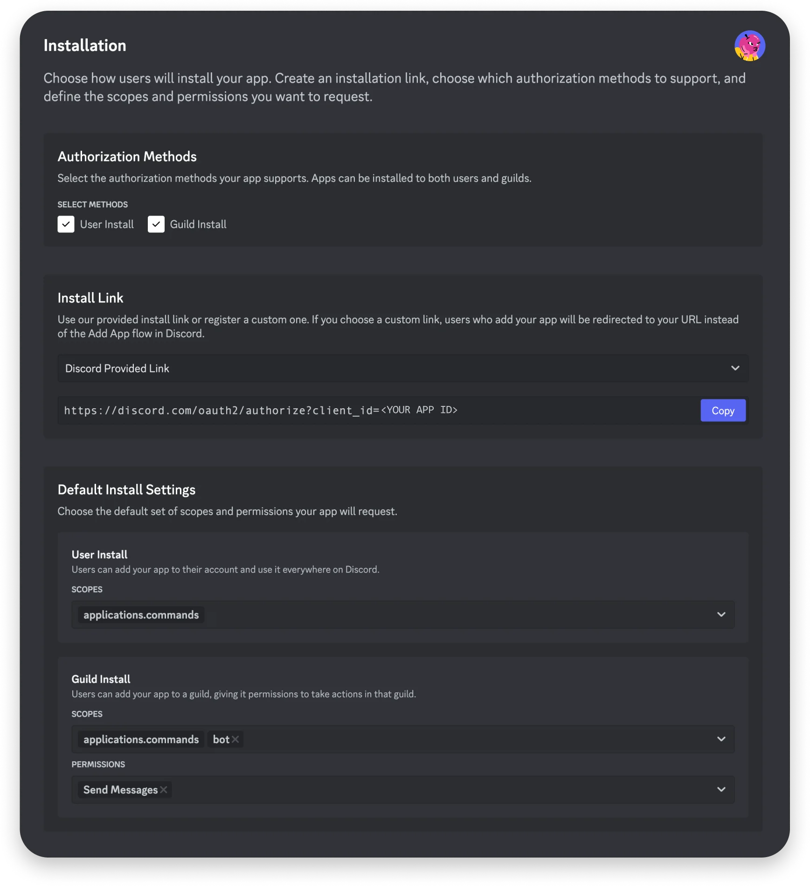

# Discord bot setup

[Back to README](../README.md) · Next: [Run Sus Link](setup.md)

## 1. Create the bot

1. Open the [Discord Developer Portal](https://discord.com/developers/applications).
2. Click **New Application**, name it **Sus Link**, and create it.
3. Open **Bot** in the sidebar. Under **Token**, click **Reset Token** to generate a token.
4. Save the token as `BOT_TOKEN` in your local `.env` file. Keep it private.

Already have a bot? Use its existing token; there is no need to reset it.

Under **Privileged Gateway Intents**, leave **Message Content Intent disabled**. Sus Link gets the selected message from Discord when you run the right-click command.

## 2. Enable User Install

Open **Installation** in the sidebar:

- Enable **User Install**, then save. **Guild Install is optional** for this owner-only bot.
- Set **Install Link** to **Discord Provided Link**.
- Under **Default Install Settings**, use these settings:

| Install type | Scopes | Bot permissions |
| --- | --- | --- |
| User Install | `applications.commands` | None |
| Guild Install (optional) | `applications.commands`, `bot` | Send Messages |

Only the User Install row is needed for your personal setup. No Administrator permission is needed. Save your changes.



*Installation settings reference provided for this project. The screenshot shows both installation types enabled; for personal use, only User Install is required. Discord may label the first section “Installation Contexts” or “Authorization Methods.”*

## 3. Install to your account

Copy the installation link from the same page, open it, and choose **Add to my apps**.

This personal installation makes Sus Link available to you in **servers, DMs with other people, and group DMs**. The bot does not need to be added to those servers. The owner check still prevents other users from running scans, and reports are visible only to you. Availability in servers remains subject to Discord's permissions for external apps.

**Optional:** If you also want a server installation, enable Guild Install, configure its scopes as shown above, open the link again, and choose **Add to server**. This is not needed for the personal workflow.

## 4. Sync manually

After [starting the bot](setup.md), open a DM directly with it and send:

```text
!sync
```

Only the bot owner can sync or run scans. Owner identity is detected automatically; no owner ID setting is needed. For team-owned apps, Discord also recognizes team developers and admins as bot owners.

Commands **never sync automatically on startup**. Enable User Install before syncing. Run `!sync` again after changing commands or installation contexts. Ordinary restarts do not require another sync. Discord may take time to display changes.

You can now right-click a message in a server, DM, or group DM and select **Apps → Sus Link Checker**. Scan reports are visible only to you.

Official references: [Create a Discord bot](https://docs.discord.com/developers/quick-start/getting-started), [user and guild installation](https://docs.discord.com/developers/tutorials/developing-a-user-installable-app).
